

  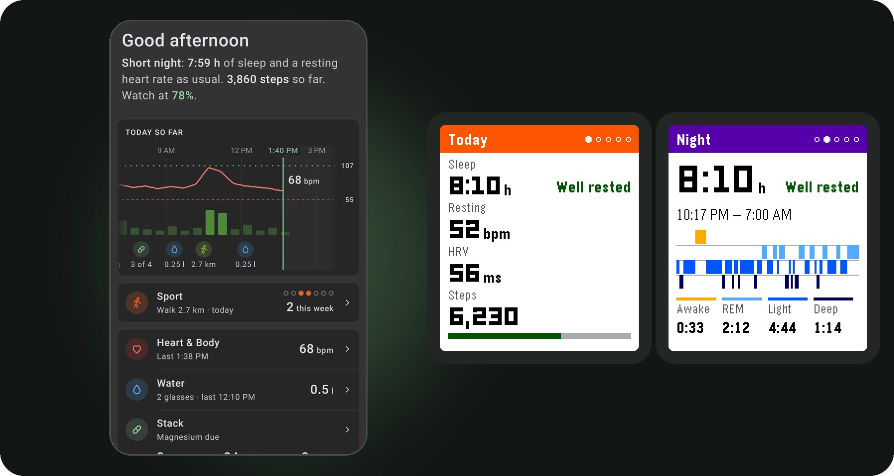

<h1 align="center">Boulder</h1>

  <b>Your Pebble, fully unleashed.</b> 
  Real sleep phases. Heart rate, HRV and blood oxygen. Workouts and turn-by-turn navigation. 
  On your wrist and in one beautiful app. Water and supplements come with two add-ons.

  <a href="https://github.com/dysseus-pascal/Boulder/releases/latest"><b>Get Boulder</b></a>
  &nbsp;·&nbsp;
  <a href="https://github.com/dysseus-pascal/boulder-firmware/releases">Boulder firmware</a>
   
  Add-ons from the Pebble App Store:
  <a href="https://apps.repebble.com/e5b37daa64c24c5cbe11dd05">Drinktervall</a>
  &nbsp;·&nbsp;
  <a href="https://apps.repebble.com/04848268a8b24e949f4eb832">SupCycle</a>

---

Boulder is the companion app that turns your Pebble into a complete health and fitness watch. It does everything you expect from the Pebble app: notifications, watchfaces, the app store, music and weather. On top of that comes a whole world of its own. Your nights get real sleep phases, your heart gets a story, your workouts get a coach on your wrist, and your bike rides get turn-by-turn directions. Together with the **Boulder firmware** for the Pebble Time 2, your watch measures more, understands more and shows you more than ever before.

It lasts for days on a charge, has an always-on screen and is readable in bright sunlight. It is still a Pebble, just a lot more of one.

## Your day at a glance

  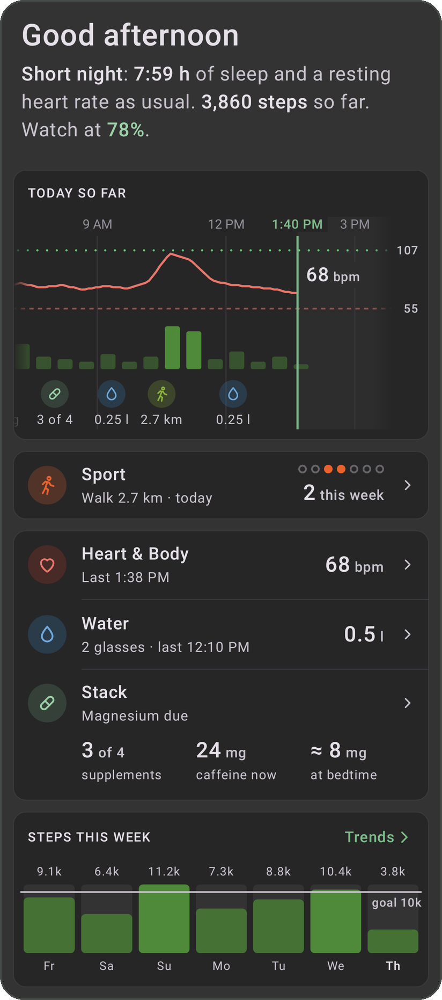

Open Boulder and your day is already told for you.

- **A greeting that gets you.** One line sums up your night, your resting heart and your steps so far, like "Short night: 7:59 h of sleep and a resting heart rate as usual."
- **Today so far.** A living timeline of your day: your heart rate curve, steps and workouts, and with the [add-ons](#add-ons) every glass of water, every coffee and every supplement. Swipe back to the morning, and when you return to the app it glides smoothly to *now*.
- **Everything one tap away.** Sport and Heart & Body each get their own card with the number that matters right now, and so do Water and your supplement Stack with the add-ons.
- **Steps this week**, day by day, measured against the goal you set yourself.

## Sleep, decoded

  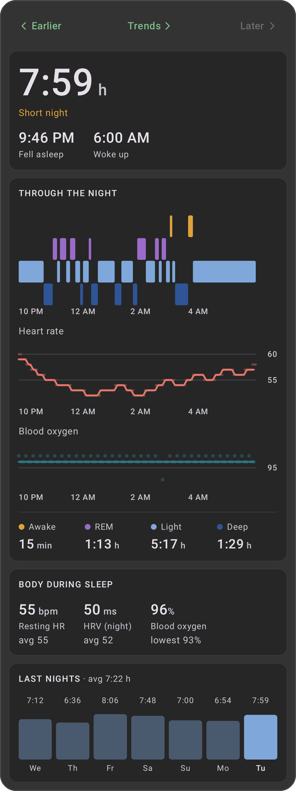

  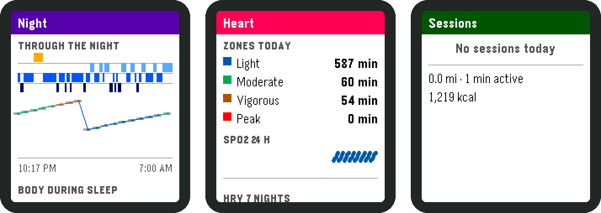

Your Pebble works through your night while you sleep and has the answer ready when you wake up.

- **Real sleep phases:** deep, light, REM and awake, worked out right on the watch every night.
- **When you fell asleep and when you woke up**, tuned night after night against a dedicated sleep tracker.
- **Your body during sleep:** heart rate, blood oxygen and HRV through the night, with your resting heart rate and lowest oxygen level.
- **A verdict at a glance:** "Well rested" or "Short night", plus your last nights side by side.
- **Blood oxygen on your terms.** Measure it all day, during workouts or only at night, and save battery where you don't need it.

## Heart & Body

  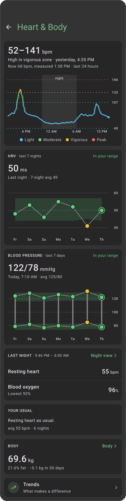

- **Heart rate all day**, with your light, moderate, vigorous and peak zones.
- **HRV with your personal range**, so you see at once whether you are recovered or running on empty.
- **Resting heart rate** compared with your usual, night after night.
- **Blood pressure and weight** from your other health apps, right next to your heart data.
- **You choose the precision.** Go from battery saver to detailed measurements with a single slider.

## The Boulder Health app on your wrist

  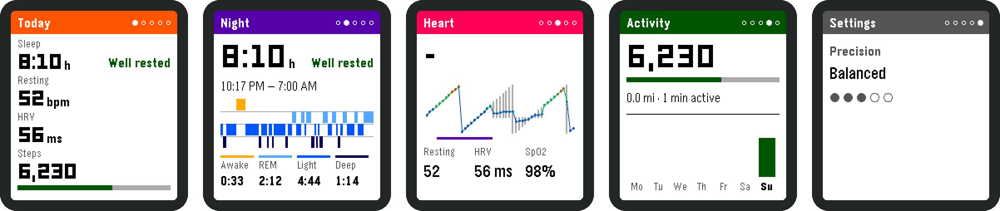

Five cards, one press of a button each: **Today, Night, Heart, Activity and Settings.** They glide just like Pebble's own cards. Your sleep, resting heart rate, HRV and steps are always on your wrist, even when your phone is miles away.

## Kieselsport: train with your Pebble

  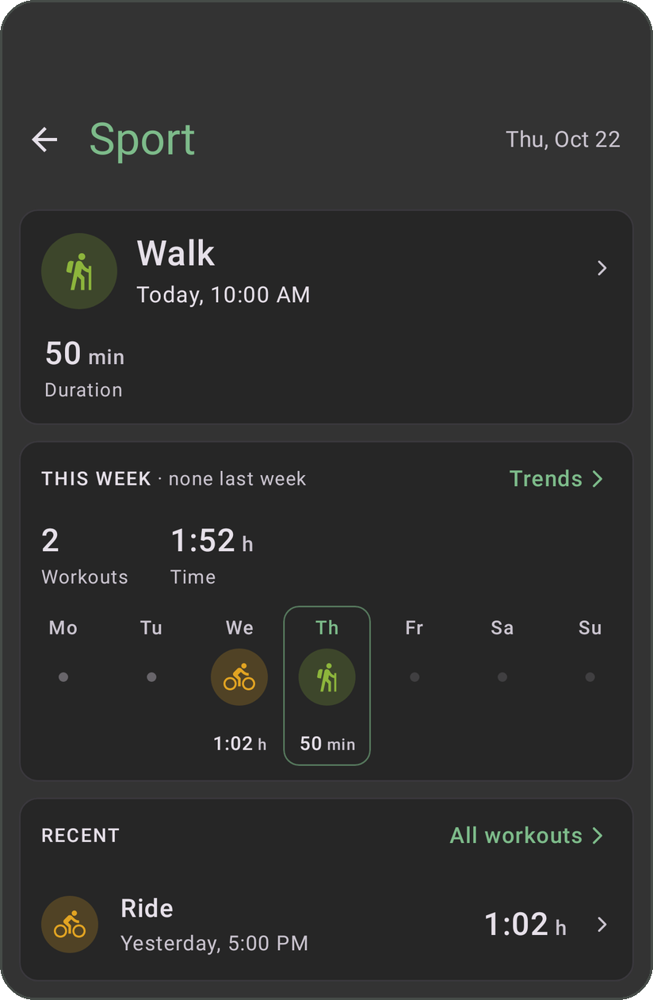

Kieselsport is the workout app built into the Boulder firmware. Pick your sport and go.

- **Running, cycling, mountain biking, swimming, yoga and more**, each with what it needs: route, laps, lengths or reps.
- **Live heart rate and zones**, with a gentle buzz when you change zone.
- **Pause whenever you like**, and a workout you forgot about ends by itself.
- **Every session lands in Boulder** with distance, heart rate and zones, and an analysis made for each sport.

### New: breathing exercises

  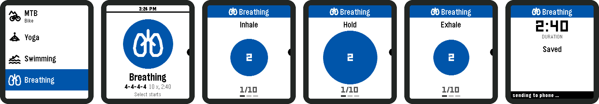

Box breathing, pranayama or your very own rhythm. Set how long to inhale, hold, exhale and hold again, and how many rounds. A calm circle grows and shrinks on your wrist with a soft buzz at every phase. When you're done, the session is saved as a workout with your heart rate and HRV.

## Kieselstrasse: turn-by-turn on your wrist, powered by OsmAnd

  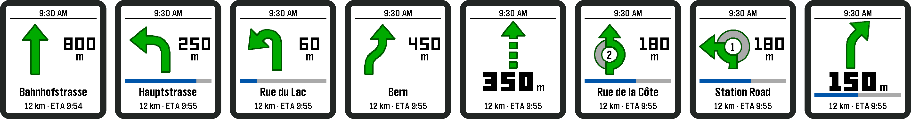

Let **OsmAnd** navigate on your phone, then put the phone in your pocket. Your Pebble shows you the way.

- **A clear arrow for every move:** straight on, left and right, slight and sharp turns, keep left and keep right, U-turns.
- **Roundabouts done right**, with the number of the exit you need to take.
- **The distance in big, bold digits** counts down to your next turn. A bar empties over the last few hundred meters so you know exactly when it's time.
- **The street name, the distance left and your arrival time**, always in view.
- **A short buzz for every new step**, so you never have to stare at your wrist.
- **The clock is always there**, and if the route goes quiet the watch tells you instead of showing old directions.

Perfect for the bike, the city and the trail, with OsmAnd's offline maps. Kieselstrasse is built into the Boulder firmware and you switch it on in Boulder under Navigation.

## Add-ons

Boulder does not need them, but they make it even better: **Drinktervall** and **SupCycle** are two separate watch apps from the Pebble App Store. Install the ones you like, and Boulder shows everything they log.

### Add-on: Drinktervall, stay hydrated

  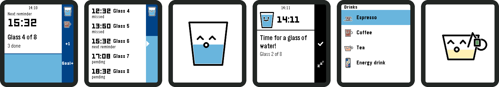

  <a href="https://apps.repebble.com/e5b37daa64c24c5cbe11dd05"><b>Get the Drinktervall add-on in the Pebble App Store</b></a>

The friendliest drinking reminder on any wrist.

- **Your glasses for the day, spread out for you**, with a reminder whenever it's time for the next one.
- **One press logs a glass**, and a little glass with a happy face pops up, empties itself and bursts into a ring of light.
- **Your drinking plan** as a tiny timeline: what you missed, what's next, what's still to come.
- **Coffee, tea and energy drinks too**, with decaf, milk and sugar.
- **Timeline pins** and a water level that rises on the main screen as your day goes on.

  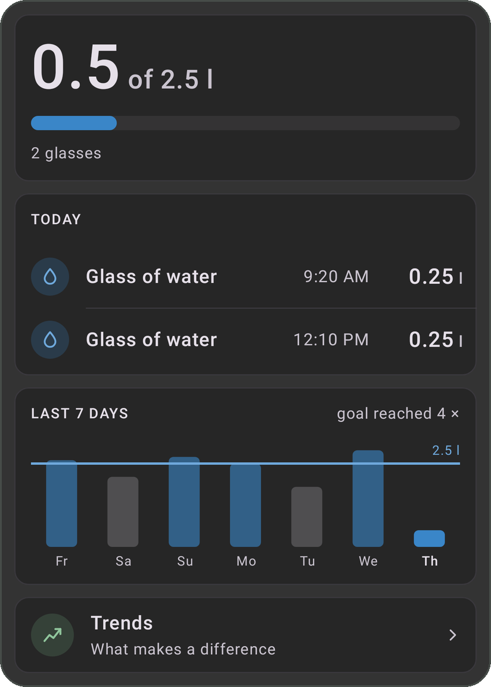

**Better with Boulder:** every glass shows up on your day's timeline and on the Water page with the last seven days. Coffee feeds straight into your caffeine curve.

### Add-on: SupCycle, supplements perfectly timed

  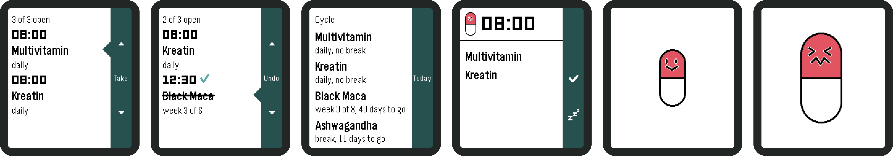

  <a href="https://apps.repebble.com/04848268a8b24e949f4eb832"><b>Get the SupCycle add-on in the Pebble App Store</b></a>

Vitamins, minerals, cures and cycles, all handled by your watch.

- **Up to six supplements**, each with its own time and rhythm: daily, every few days, or as a cycle of weeks on and weeks off.
- **SupCycle knows where you are in every cycle** and stays quiet during the break.
- **Reminders right on time:** take it, snooze it or let it go. Anything you missed waits on the Today screen.
- **Take a dose and Pilly the capsule pops up**, gets a good shake and vanishes in a puff.
- **Runs on its own** once it's set up, phone or no phone.

  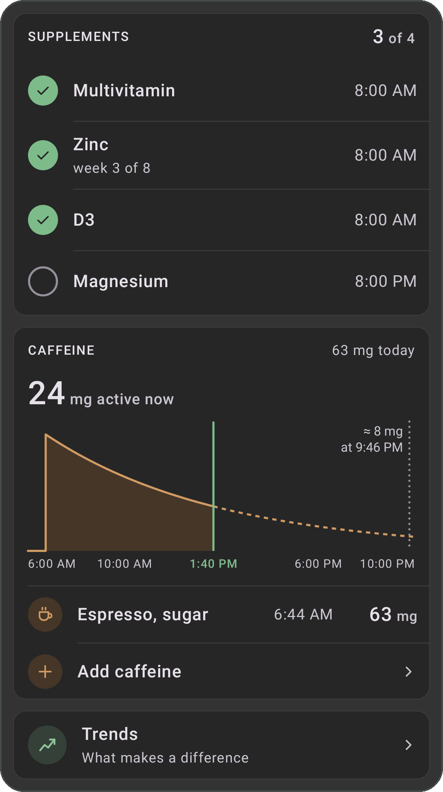

**Better with Boulder:** the Stack page shows what you have taken and what is still due. It also shows how much caffeine is active in your body right now, and how much will be left at bedtime.

## Everything in its place

- **Health Connect.** Boulder writes your sleep with phases, heart rate, resting heart rate, HRV, workouts, water and supplements to Health Connect, and reads what your other apps put there.
- **Your goals.** Set your steps per day and your sleep per night. Boulder and your watch measure everything against them.
- **Trends.** See what makes a difference for your sleep and your heart.
- **A home screen widget** that shows your day without even opening the app.
- **Backups** to a folder of your choice, and an easy move over from Kiesel-Helper.
- **Your own server and Claude.** Optionally mirror your health data to your own little server and ask Claude about it: "How did I sleep this week?"
- **Private by design.** Your health data stays on your phone, or on your own server if you want it there. No tracking, no ads, and no crash reports sent anywhere.

## The Boulder firmware

Everything that happens on your wrist comes from the **Boulder firmware** for the Pebble Time 2: the sleep analysis, the Health app, Kieselsport, the breathing exercises and Kieselstrasse. Boulder brings you new versions automatically, right in the app. Every update is signed, and Boulder only installs the real thing.

## Get started

1. **Download Boulder** from the [latest release](https://github.com/dysseus-pascal/Boulder/releases/latest) and install it. Boulder takes the place of the Pebble app on your phone, so keep one or the other.
2. **Pair your Pebble** and let Boulder update it to the Boulder firmware.
3. **Connect OsmAnd** under Navigation for Kieselstrasse.
4. **Pick your add-ons** if you like: Drinktervall and SupCycle from the Pebble App Store.
5. **Wear it.** Your first night tells you more than you'd think.

## Credits

Boulder is an independent, unofficial project. It is built on the open-source Pebble app by [Core Devices](https://github.com/coredevices/mobileapp) and grew out of Gravel and Kiesel-Helper. It is not affiliated with or endorsed by Core Devices. Pebble and Pebble Time are trademarks of their respective owners.

Licensed under the GNU GPL v3, see [LICENSE](LICENSE). Want to build it yourself? See [BUILDING.md](BUILDING.md).
